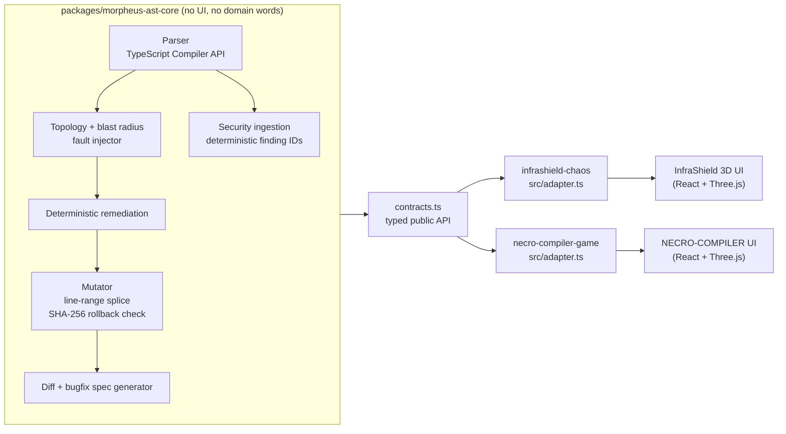

# MORPHEUS-AST

**One headless, domain-agnostic code-analysis engine (the skeleton) powering two completely different apps: a cloud-resilience chaos auditor and a 3D gothic dungeon game where you refactor real code.**

Kiroween 2026 entry, **Skeleton Crew** category.

## Live demos

| App | What it is | URL |
|---|---|---|
| **NECRO-COMPILER** | 3D gothic dungeon crawler. Monsters are code smells, spells are real code edits. | https://necro-compiler.vercel.app |
| **InfraShield 3D** | "Cyber City" resilience auditor. Inject a fault, see the blast radius, apply a patch. | https://infrashield-3d.vercel.app |
| **Landing site** | Static hub page that links to both demos. Not a third app. | https://morpheus-ast.vercel.app |

Both demos are public, need no login, and run the engine in the browser on a pre-loaded three-file sample repository.

## How it works



The core exposes one factory, `createEngine()`, typed by `packages/morpheus-ast-core/src/contracts.ts`. What it does:

- **Parser.** Parses disk or in-memory files with the TypeScript Compiler API (default, no `.wasm` asset needed in the browser). An optional Tree-sitter WASM parser exists and releases every tree with `tree.delete()`.
- **Topology and blast radius.** Builds a cross-file call graph with complexity, cycle detection, unused variables and uncaught-exception paths. The fault injector computes cascade, taint paths and centrality for four fault types: `LATENCY`, `NETWORK_FAILURE`, `EXTREME_PAYLOAD`, `UNCAUGHT_EXCEPTION`.
- **Security ingestion.** Normalises SonarQube, Snyk, AWS and Aikido reports into one finding shape with deterministic finding IDs (same input gives the same IDs; exact duplicates get distinct but stable IDs).
- **Deterministic remediation.** `planRemediation` turns an unused-variable or uncaught-exception finding into surgical splices without any AI service.
- **Mutator.** Applies splices by byte range, in descending order, throws `SpliceConflictError` on overlap, and stores a `RollbackRecord`. A SHA-256 fingerprint (`fingerprintText`) proves that rollback restored the original text exactly.
- **Diff and bugfix spec generator.** Produces a line diff of a mutation and a `bugfix.md` document (Current Behavior, Expected Behavior, Unchanged Behavior).

Each app has one composition root, `src/adapter.ts`. It is the only app file that may import `createEngine()` from the core. All UI code imports from `./adapter` only.

## NECRO-COMPILER

You play a necromancer-refactorer in a 3D dungeon built from real source code. Rooms are files, corridors are call edges, monsters are defects, and boss rooms hold high-complexity functions.

1. Load the page. The dungeon is built from the sample repository.
2. **Click a monster** to select it. The camera glides to its room.
3. Press **Cast Refactoring Spell** (or **Enter**). The adapter applies a real surgical mutation to the in-memory source and the monster is purified.
4. Press **Undo** (or **Cmd/Ctrl+Z**). The source is restored byte for byte.
5. Press **I** to open the **Inspector**: the real diff of what the spell changed, with SHA-256 fingerprints.
6. **Esc** clears the selection.

Monsters with no safe automated fix show lore text instead of a cast button. The HUD shows a monster counter and a purified counter.

## InfraShield 3D

You are an SRE looking at a "Cyber City". Functions are buildings (height is complexity), call edges are roads.

1. Click a building to pick a target. The default target is the highest-centrality function.
2. **Choose a fault type** from the dropdown.
3. Click **Inject Fault**. The target pulses red, the cascade spreads in amber.
4. **Read the blast radius** in the SRE dashboard: score, cascade list, topology metrics and security findings.
5. Review the patch card (deterministic rule-based patch), then **Apply Patch**. **Rollback** restores the original source.
6. **Generate Bugfix Spec**, then **Download bugfix.md**.
7. Press **I** for the **Inspector** with the diff and SHA-256 rollback verification.

## Landing site (`site/`)

`site/` is a static marketing and hub page. It does not import the core or either app, and it is **not** a third Skeleton Crew app. The Skeleton Crew apps remain `apps/infrashield-chaos` and `apps/necro-compiler-game`.

Build it with `pnpm run build:site`. First-time visitors get a short tour, and each app offers "Switch world" links to jump to the other one.

## Why this is a Skeleton Crew entry

- **One skeleton, two bodies.** `packages/morpheus-ast-core` is shared by `apps/infrashield-chaos` and `apps/necro-compiler-game`. Neither app contains analysis or mutation logic.
- **Zero domain vocabulary in core.** The core never says monster, dungeon, spell, lambda, chaos, serverless or SRE. `scripts/check-boundaries.mjs` enforces this.
- **Boundary rules checked by `pnpm run lint:boundaries`:**
  - R1: core never imports from `apps/`.
  - R2: core `package.json` has no UI framework dependency.
  - R3: apps import core only through `src/contracts`. The single exception is `apps/<app>/src/adapter.ts`, which may also import `src/index` to call `createEngine()`.
  - R4: no TypeScript `any` in core.
  - R5: no application vocabulary in core source or tests.
- **Two opposite domains.** One app is a serious SRE tool, the other is a horror game, over the same engine and the same sample repository.

## Tech stack

- TypeScript 5.4 (strict), pnpm workspaces
- Core: TypeScript Compiler API, `web-tree-sitter` (optional parser), `@aws-sdk/client-bedrock-runtime` (optional advisor), Jest, fast-check
- Apps: React 18, Three.js 0.168, Vite 5, Vitest 2, fast-check
- NECRO also uses custom GLSL shaders and `@fontsource/cinzel`

## Local setup

Requires Node >= 20 and pnpm >= 9.

```bash
pnpm install

pnpm --filter necro-compiler-game dev   # NECRO-COMPILER
pnpm --filter infrashield-chaos dev     # InfraShield 3D
```

The apps import the core from source, so no core build step is needed to run them.

## Tests and checks

```bash
pnpm run lint:boundaries                  # import boundaries, no `any`, no domain words in core
pnpm run typecheck                        # all packages
pnpm test                                 # core: all Jest tests
pnpm run test:pbt                         # core: fast-check property tests (tests/pbt)
FC_RUNS=2000 pnpm run test:pbt            # heavier property run

pnpm --filter necro-compiler-game test    # app tests (Vitest, includes property and perf tests)
pnpm --filter infrashield-chaos test

pnpm run verify:adapters                  # both adapters against the real engine
pnpm run verify:dist                      # real core build, exports map, deep-import block
node scripts/scan-secrets.mjs             # secret scan
```

Property tests live in `packages/morpheus-ast-core/tests/pbt/` and in `__tests__` folders of both apps. See [docs/KIRO_USAGE.md](docs/KIRO_USAGE.md) for what each one checks.

## Project structure

```
.
├── .kiro/
│   ├── hooks/                 3 hook files (4 hooks)
│   ├── settings/mcp.json      MCP server configuration
│   ├── specs/                 7 feature specs + bugfixes/
│   └── steering/              4 steering files
├── apps/
│   ├── infrashield-chaos/     InfraShield 3D
│   │   └── src/
│   │       ├── adapter.ts     composition root
│   │       ├── components/    city scene, panels (dashboard, inspector, bugfix)
│   │       ├── layout/        deterministic force layout, camera framing
│   │       └── engine/        lazy adapter loader
│   └── necro-compiler-game/   NECRO-COMPILER
│       └── src/
│           ├── adapter.ts     composition root
│           ├── components/    dungeon scene, atmosphere, camera
│           ├── entities/      monster scale, placement, config
│           ├── spells/        cast / undo state and keys
│           ├── shaders/       GLSL
│           ├── hud/           HUD, inspector
│           └── perf/          performance tests
├── packages/
│   └── morpheus-ast-core/
│       ├── src/
│       │   ├── contracts.ts   the only public typed API
│       │   ├── index.ts       createEngine()
│       │   ├── parser/        TypeScript API + Tree-sitter
│       │   ├── topology/      call graph, complexity
│       │   ├── blast-radius/  fault injector
│       │   ├── security/      scanner ingestion
│       │   ├── remediation/   deterministic fixes
│       │   ├── mutator/       splice, rollback, diff, fingerprint, bugfix spec
│       │   ├── bedrock-advisor/
│       │   └── sample-repo/
│       └── tests/pbt/         property and unit tests
├── site/                      static landing page (not a Skeleton Crew app)
├── scripts/                   check-boundaries, scan-secrets, verify-adapters, verify-dist
├── docs/KIRO_USAGE.md
└── LICENSE
```

## Honest note on AI

An Amazon Bedrock advisor exists in the core (`src/bedrock-advisor/`). It validates model output strictly and is tested with an injected stub client. It has **not** been exercised against a real Bedrock call (open item in `.kiro/specs/core-engine/tasks.md`).

The public demos use the **deterministic, rule-based remediation** (`planRemediation`), so **no AWS credentials are needed** to run or try anything. Patches in the demo are labelled as deterministic.

## Team

- **Althaf**: core engine (`packages/morpheus-ast-core`)
- **Bryan Carlie**: frontend and 3D (both apps' UI)

## License

[MIT](LICENSE)
